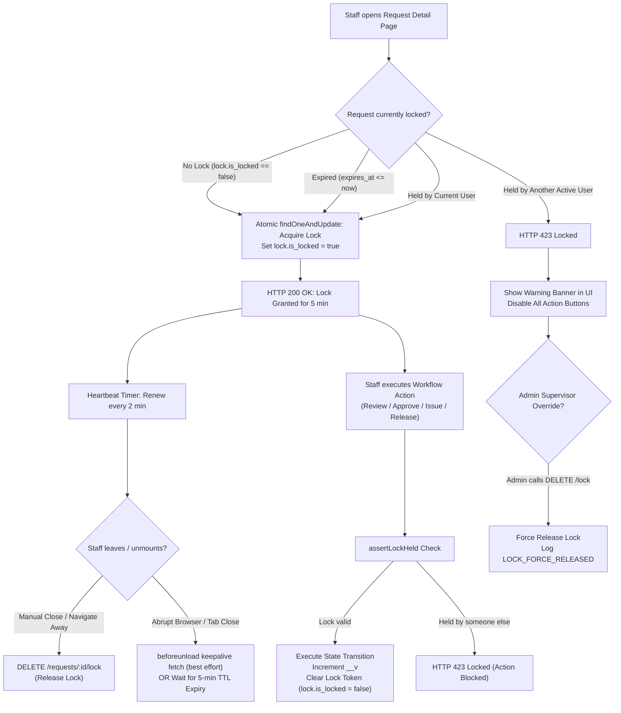

# Concurrency Control Specification & Implementation Guide

## 1. Executive Summary

In municipal government and barangay document issuance systems, multiple staff members simultaneously review, verify, print, and release legal public certificates (e.g., Barangay Clearance, Certificate of Indigency, Certificate of Residency, Business Clearances). 

Without robust concurrency control, concurrent staff interactions cause severe operational anomalies:
* **Duplicate Physical Printing:** Two officers prepare and sign separate certificate documents for the same request, assigning divergent certificate numbers and wasting tamper-evident official stationery.
* **Conflicting Workflow Transitions:** Officer A approves an application while Officer B rejects it for insufficient identification, creating race conditions and confusing residents.
* **Lost Updates:** Changes to internal processing notes, payment receipts, or verification codes overwrite one another without warning.

QuickFile solves this problem through a multi-tier concurrency control architecture:
1. **Primary Control:** Document-level **Pessimistic Locking** with automatic heartbeats, TTL expiration safety, and administrative overrides.
2. **Safety Net:** Schema-level **Optimistic Concurrency Control (OCC)** using Mongoose's versionKey (`__v`), catching edge cases where locks expire mid-operation or concurrent transactions attempt simultaneous mutations.
3. **Storage Engine Baseline:** MongoDB **WiredTiger Multi-Version Concurrency Control (MVCC)** for storage-engine atomicity and non-blocking reads.

### 1.1 Runtime context

The `quickfile` database on **MongoDB Atlas** is the single source of truth; every app instance shares the same lock documents, so a lock acquired through one server is immediately visible to all others. The application-level transaction helper (`backend/src/helpers/transaction.js`) uses snapshot reads and majority writes so that certificate issuance, status transitions (status + audit log + notification), and password resets commit atomically. On a standalone local MongoDB the helper degrades gracefully; Atlas and the local test replica set (`--replSet quickfile`) provide real transactions. See [backend/docs/ATLAS.md](../backend/docs/ATLAS.md) for the Atlas runbook.

---

## 2. Comparative Analysis of Concurrency Control Approaches

| Dimension | Locking (Implemented) | Multi-Version Concurrency Control (MVCC) | Timestamp Ordering |
| :--- | :--- | :--- | :--- |
| **Primary Mechanism** | Document-level pessimistic lock token with optimistic `__v` safety net. | Multi-version data snapshots managed in-memory by the storage engine. | Monotonically increasing logical or physical clock values assigned to operations. |
| **Conflict Resolution** | Explicit rejection (HTTP 423 Locked / HTTP 409 Conflict) preventing conflicting work before it starts. | Transaction rollback/retry on write-write conflicts; non-blocking read snapshots. | Abort and restart transactions that arrive out of timestamp order. |
| **Read Impact** | Reads are completely non-blocking (`GET` does not require lock ownership). | Reads access consistent point-in-time snapshots without shared read locks. | Reads must verify read timestamps against latest write timestamps. |
| **Write Impact** | Exclusive ownership required before mutation; serialized document updates. | Document-level write locking during commit; aborts on concurrent write to same record. | Older transactions aborted if younger transactions have already written to record. |
| **Fit for Barangay Workflow** | **Highest:** Staff examine physical documents and spend minutes reviewing. Mutual exclusion avoids wasted manual labor. | Foundation layer: Guarantees underlying document atomicity without manual transaction handling. | Secondary: `updated_at` / `__v` detect staleness, but pure timestamp aborts discard completed manual data entry. |

### 2.1 Pessimistic vs. Optimistic Locking

* **Why Pessimistic Locking Fits the Staff Processing Workflow:**
  In automated e-commerce or high-throughput banking, transactions execute in milliseconds, making Optimistic Concurrency Control (OCC) ideal because write collisions are rare and rolling back is cheap.
  
  However, Barangay document processing involves **human-in-the-loop manual labor**:
  * Staff members review uploaded attachments (valid IDs, proofs of billing).
  * Staff inspect resident records, verify standing in the community, and calculate fees.
  * Staff generate official Word/PDF documents, insert official certificate numbers, print physical copies on municipal letterhead, and obtain physical signatures from Barangay Captains and Secretaries.

  If an optimistic approach alone were used, Staff Member A and Staff Member B could both spend 5 minutes reviewing and physically stamping the same citizen's application. The second officer to click "Issue" would receive an error ("Record modified by another user"), rendering their 5 minutes of physical and administrative work completely invalid. 

  **Pessimistic locking prevents this by establishing exclusive possession the moment a staff member opens the request detail page.** Competing staff members see a prominent warning banner ("Locked by Staff Maria until 10:15 AM") and have their action buttons disabled immediately.

* **Optimistic Versioning (`__v`) as a Safety Net:**
  While pessimistic locks prevent concurrent manual editing, edge cases exist:
  * A staff member leaves their computer idle until the 5-minute lock TTL expires, and another staff member takes over. If the original officer returns and clicks a button, OCC detects that `__v` has been incremented and aborts the stale write with HTTP 409 Conflict.
  * Direct API interactions or simultaneous automated worker jobs bypassing the lock service are immediately blocked by Mongoose's `optimisticConcurrency: true`.

### 2.2 Multi-Version Concurrency Control (MVCC) in MongoDB WiredTiger

Underneath the application layer, MongoDB's default storage engine, **WiredTiger**, implements Multi-Version Concurrency Control (MVCC):
1. **In-Memory Cache Snapshots:** When an operation reads data, WiredTiger provides a point-in-time snapshot of the requested documents. Readers never acquire shared read locks, and writers never acquire exclusive locks that block readers.
2. **Transaction Timestamps:** WiredTiger assigns internal transaction timestamps to operations. Document modifications allocate new memory versions rather than overwriting in-place immediately.
3. **Write-Write Isolation:** When two concurrent writes target the exact same document, WiredTiger's document-level concurrency controls serialize the commit. If an uncommitted write is in flight, the second write yields or waits, ensuring underlying atomic consistency without table- or collection-level locking.

### 2.3 Timestamp Ordering & Sequence Versioning

* **Logical vs. Physical Timestamps:** Physical clock timestamps (`created_at`, `updated_at`) are prone to NTP clock drift across distributed server instances.
* **Mongoose Versioning (`__v`):** Rather than relying on physical wall-clock timestamps for transaction ordering, Mongoose uses an integer sequence counter (`__v`). Each atomic write increments `__v` by 1 (`$inc: { __v: 1 }`).
* When an update is submitted, Mongoose compares the document's in-memory `__v` against the current database `__v`. If the database `__v` is higher, an intervening write has taken place, and Mongoose raises a `VersionError` (mapped to HTTP 409 Conflict).

---

## 3. Architecture & Lock Lifecycle

### 3.1 Lock Schema Definition (`DocumentRequest.lock`)

The `DocumentRequest` schema includes an embedded subdocument for pessimistic locking alongside the Mongoose `optimisticConcurrency` flag:

```javascript
// DocumentRequest Schema Excerpt
const documentRequestSchema = new mongoose.Schema(
  {
    tracking_number: { type: String, required: true, unique: true, index: true },
    status: { type: String, required: true, enum: Object.values(REQUEST_STATUSES), index: true },
    // ...
    lock: {
      // Fast boolean mirror of the active-lock state. requestLock.service.js
      // and requestTransition.js keep it in sync on acquire, renew, release
      // and status transitions; GET /lock also returns it at the top level.
      is_locked: {
        type: Boolean,
        default: false,
      },
      locked_by: {
        type: mongoose.Schema.Types.ObjectId,
        ref: 'User',
        default: null,
      },
      locked_by_name: {
        type: String,
        default: null,
      },
      locked_at: {
        type: Date,
        default: null,
      },
      expires_at: {
        type: Date,
        default: null,
      },
    },
  },
  {
    timestamps: { createdAt: 'created_at', updatedAt: 'updated_at' },
    optimisticConcurrency: true,
    versionKey: '__v',
  }
);

documentRequestSchema.index({ 'lock.locked_by': 1 });
documentRequestSchema.index({ 'lock.expires_at': 1 });
```

### 3.2 Lock Lifecycle Flowchart



---

## 4. REST API Endpoint Specifications

All locking endpoints are noun-based, adhere to standard REST architectural conventions, operate under `/api/v1/staff/requests/:id/lock`, and are protected by `authenticate`, `authorize('staff', 'admin')`, `requirePermission('can_review_requests')`, and `userApiLimiter`. The `Authorization: Bearer` headers in the examples below are for API clients and automated tests; browser clients authenticate with the httpOnly session cookie set at login.

### 4.1 Endpoint Summary Table

| Method | URI Path | Required Permission | Success Code | Conflict Code | Description |
| :--- | :--- | :--- | :--- | :--- | :--- |
| `PUT` | `/api/v1/staff/requests/:id/lock` | `can_review_requests` | `200 OK` | `423 Locked`<br/>`404 Not Found` | Atomically acquires or renews a pessimistic lock for 5 minutes. |
| `DELETE` | `/api/v1/staff/requests/:id/lock` | `can_review_requests` (or `role: admin`) | `200 OK` | `403 Forbidden`<br/>`404 Not Found` | Releases the held lock. Regular staff can only release their own locks; administrators can force-release any lock. |
| `GET` | `/api/v1/staff/requests/:id/lock` | `can_review_requests` | `200 OK` | `404 Not Found` | Retrieves current lock status, remaining validity, and lock holder attribution. |

---

### 4.2 Request and Response Payloads

#### 1. Acquire or Renew Lock: `PUT /api/v1/staff/requests/:id/lock`

* **Request Headers:**
  ```http
  PUT /api/v1/staff/requests/673752e257db123456789abc/lock HTTP/1.1
  Host: quickfile.local
  Authorization: Bearer <jwt_staff_token>
  Content-Type: application/json
  ```
* **Request Body:** `{}` (optional duration override in development)

* **Success Response (`200 OK`):**
  ```json
  {
    "success": true,
    "message": "Lock acquired successfully.",
    "data": {
      "is_locked": true,
      "locked_by": "6737520057db123456789100",
      "locked_by_name": "Staff Maria Santos",
      "locked_at": "2026-11-16T08:30:00.000Z",
      "expires_at": "2026-11-16T08:35:00.000Z"
    }
  }
  ```

* **Conflict / Locked Response (`423 Locked`):**
  ```json
  {
    "success": false,
    "message": "Request is currently locked by Staff Juan Dela Cruz until 8:35:00 AM. Please wait or select another request.",
    "data": {
      "lock": {
        "is_locked": true,
        "locked_by": "6737520057db123456789200",
        "locked_by_name": "Staff Juan Dela Cruz",
        "locked_at": "2026-11-16T08:30:00.000Z",
        "expires_at": "2026-11-16T08:35:00.000Z"
      }
    }
  }
  ```

---

#### 2. Release Lock: `DELETE /api/v1/staff/requests/:id/lock`

* **Request Headers:**
  ```http
  DELETE /api/v1/staff/requests/673752e257db123456789abc/lock HTTP/1.1
  Host: quickfile.local
  Authorization: Bearer <jwt_staff_token>
  ```

* **Success Response (`200 OK`):**
  ```json
  {
    "success": true,
    "message": "Lock released successfully.",
    "data": null
  }
  ```

* **Forbidden Response (`403 Forbidden` - Staff attempting to release another user's lock):**
  ```json
  {
    "success": false,
    "message": "Forbidden: You cannot release a lock held by Staff Juan Dela Cruz.",
    "data": null
  }
  ```

---

#### 3. Query Lock Status: `GET /api/v1/staff/requests/:id/lock`

* **Request Headers:**
  ```http
  GET /api/v1/staff/requests/673752e257db123456789abc/lock HTTP/1.1
  Host: quickfile.local
  Authorization: Bearer <jwt_staff_token>
  ```

* **Success Response (`200 OK`):**
  ```json
  {
    "success": true,
    "message": "Lock status retrieved.",
    "data": {
      "is_locked": true,
      "is_held_by_current_user": false,
      "lock": {
        "is_locked": true,
        "locked_by": "6737520057db123456789200",
        "locked_by_name": "Staff Juan Dela Cruz",
        "locked_at": "2026-11-16T08:30:00.000Z",
        "expires_at": "2026-11-16T08:35:00.000Z"
      }
    }
  }
  ```

---

#### 4. Optimistic Concurrency Conflict: `HTTP 409 Conflict`

When two requests pass through concurrent race conditions or when an update occurs against a stale `__v`:

```json
{
  "success": false,
  "message": "Conflict: The record was modified by someone else and should be reloaded.",
  "data": null
}
```

---

## 5. Audit Logging Specifications

Every lock lifecycle event is recorded in the append-only `AuditLog` collection for forensics and administrative compliance:

| Action Identifier | Trigger Condition | Logged Actor | Details Recorded |
| :--- | :--- | :--- | :--- |
| `LOCK_ACQUIRED` | Staff acquires lock on previously unlocked document. | Current User | `tracking_number`, `locked_at`, `expires_at`, `duration_ms` |
| `LOCK_EXPIRED_TAKEOVER` | Staff acquires lock where previous `expires_at < now`. | New Lock Holder | `tracking_number`, `locked_at`, `expires_at`, previous holder info |
| `LOCK_RELEASED` | Holder releases lock via `DELETE`, or lock is automatically released upon state transition. | Lock Holder / Actor | `tracking_number`, `released_holder_id`, `trigger` |
| `LOCK_DENIED` | Staff attempts to acquire, renew, or mutate a document locked by another user. | Blocked Staff User | `tracking_number`, `holder_id`, `holder_name`, `expires_at` |
| `LOCK_FORCE_RELEASED` | Administrator overrides and terminates an active lock held by another staff member. | Admin User | `tracking_number`, `released_holder_id`, `released_holder_name`, `was_forced: true` |
| `VERSION_CONFLICT` | Mongoose raises `VersionError` due to mismatched `__v` on document save. | Stale Editor User | `path`, `method`, `error` |

---

## 6. Known Limitations & Mitigation Strategies

### 6.1 Lock Expiration During Prolonged Manual Review
* **Scenario:** A staff member is on the phone verifying a resident's details for more than 5 minutes without interacting with the page.
* **Mitigation:**
  1. The frontend initiates a silent renewal heartbeat every **2 minutes** (`acquireOrRenewLock`) while the detail page remains open and mounted.
  2. If the network drops or the staff member's computer goes to sleep for more than 5 minutes, the lock expires.
  3. If another staff member opens the request, they take it over via `LOCK_EXPIRED_TAKEOVER`.
  4. If the original staff member wakes their PC and attempts an action, `assertLockHeld` blocks them with HTTP 423, and `optimisticConcurrency` prevents data corruption.

### 6.2 Abrupt Browser Crash or Sudden Tab Close
* **Scenario:** A staff member closes their browser window or experiences a power interruption while holding a lock.
* **Mitigation:**
  1. **BeforeUnload Keepalive Hook:** On window close or reload, the frontend fires a native `fetch()` call to `DELETE /lock` using `{ keepalive: true }`. This guarantees transmission even if the page teardown finishes before the response returns.
  2. **TTL Expiration Window:** Even if the network disconnects before `beforeunload` fires, the lock naturally expires in **5 minutes** (`expires_at < now`). No background cleanup cron or database TTL index is required, as `acquireLock` checks `expires_at <= now` directly within the atomic query.
  3. **Admin Force-Release:** Administrators can immediately release a locked document from the management portal without waiting for the 5-minute timeout.

### 6.3 Clock Skew Across Application Servers
* **Scenario:** Multiple Node.js backend cluster instances have slightly unsynchronized system clocks.
* **Mitigation:**
  1. Lock validity is calculated using database time and UTC ISO-8601 timestamps.
  2. The frontend compares timestamps relative to server responses rather than relying solely on local client device clocks.
  3. Lock durations of 5 minutes provide a generous safety margin against sub-second NTP jitter.

### 6.4 Direct Database Access / Non-Locking Mutation Bypass
* **Scenario:** A maintenance script or future API endpoint updates a `DocumentRequest` without calling `requestLockService.assertLockHeld`.
* **Mitigation:**
  1. Mongoose's `optimisticConcurrency: true` is enforced at the schema level.
  2. Any call to `doc.save()` automatically validates the current `__v` against the database record. If an intervening update occurred, the mutation fails with HTTP 409 Conflict regardless of whether pessimistic locks were engaged.

### 6.5 `lock.is_locked` as a derived mirror

`lock.is_locked` is a fast boolean mirror of the active-lock state, not the authority by itself. `getLockStatus()` prefers the stored boolean but also checks that `locked_by` is set and `expires_at` is in the future; for legacy documents that have not been backfilled it falls back entirely to that derived check. This means an expired lock is reported as unlocked even if a stale `true` value remains in the database. Always go through `requestLock.service.js` and `requestTransition.js` rather than writing `lock.*` fields directly so the mirror stays in sync.
