# QuickFile Database: SQL Schema and Normalization Analysis (1NF → 2NF → 3NF)

**Prepared for:** database design coursework / system documentation
**Subject database:** the `quickfile` MongoDB database used by the QuickFile Barangay Document Request & Management System
**Scope:** every collection in `backend/src/models/` — **14 model files** plus the `index.js` barrel export (15 files total)
**Target normal form:** Third Normal Form (3NF), with explicitly justified snapshot denormalizations

---

## Table of Contents

1. [Introduction and Method](#1-introduction-and-method)
2. [Inventory of the Current MongoDB Schema](#2-inventory-of-the-current-mongodb-schema)
3. [Unnormalized Form: the Current Design Treated as Relations](#3-unnormalized-form-the-current-design-treated-as-relations)
4. [First Normal Form (1NF)](#4-first-normal-form-1nf)
5. [Second Normal Form (2NF)](#5-second-normal-form-2nf)
6. [Third Normal Form (3NF)](#6-third-normal-form-3nf)
7. [Final Relational Schema (SQL DDL)](#7-final-relational-schema-sql-ddl)
8. [Entity–Relationship Diagram](#8-entityrelationship-diagram)
9. [Comparison: Current MongoDB vs. Proposed SQL](#9-comparison-current-mongodb-vs-proposed-sql)
10. [Conclusion](#10-conclusion)

---

## 1. Introduction and Method

QuickFile is currently backed by **MongoDB Atlas**. Its data model is document-oriented: related data is embedded inside a document (`lock`, `attachments`, `form_data`) and references between documents are stored as `ObjectId` values. That design is intentional in a NoSQL system — embedding reduces joins and suits the way the application reads a request as one aggregate.

This report answers a different question: **if the same information had to live in a relational database, what would the schema look like, and how would it be normalized?**

### Mapping rules used

| MongoDB concept | Relational equivalent used here |
| --- | --- |
| Collection | Table |
| Document | Row |
| `ObjectId` primary key | `CHAR(24)` surrogate key (the 24-character hex form of an ObjectId) |
| `ObjectId` reference (`ref: 'User'`) | Foreign key with `ON DELETE RESTRICT` (or `SET NULL` where the field is optional) |
| Embedded subdocument (one-to-one) | Child table with a unique foreign key (or columns merged into the parent) |
| Embedded array (one-to-many) | Child table with a foreign key back to the parent |
| `Mixed` / schemaless object | Either typed columns, or a controlled EAV table (`entity_id`, `key`, `value`) |
| Enum (string field) | `CHECK` constraint listing the allowed values |
| `timestamps` | `created_at` / `updated_at` columns |

### Why the "as-is" design is not normalized

Normalization theory assumes a relation (a table whose cells hold single, atomic values). A MongoDB document with an array field such as `attachments` is **not** a relation in that sense — it is a nested structure. To compare fairly, Section 3 "flattens" each document into a hypothetical wide table. That wide table is our **Unnormalized Form (UNF)** and the 1NF → 2NF → 3NF work starts there.

Preserved throughout: the status vocabulary (9 request states), enum values, uniqueness rules and indexes from `backend/src/config/constants.js` and the Mongoose schemas.

---

## 2. Inventory of the Current MongoDB Schema

The table below lists all 14 collections as they exist today (field names taken directly from the Mongoose models).

| # | Collection | Purpose | Key fields / notable structures |
| --- | --- | --- | --- |
| 1 | `users` | All accounts (admin, staff, citizen) | `email` (unique), `password_hash`, `full_name`, `phone`, `role`, `is_active`, `google_id` (sparse unique), login timestamps |
| 2 | `citizenprofiles` | Resident identity & address details | `user_id` (unique), name parts, `birthdate`, `gender`, address, `voter_status` (barangay staff/admin-managed; citizens cannot change it), `valid_id_type`, `valid_id_number` |
| 3 | `staffdetails` | Staff employment details | `user_id` (unique), `employee_id`, `position`, `department`, `contact_number` |
| 4 | `staffpermissions` | Staff capability flags | `user_id` (unique), 7 `can_*` booleans |
| 5 | `documenttypes` | Catalog of issuable documents | `code` (unique), `fee`, `processing_days`, `requirements: [String]`, `template_mode`, `active_template_id` |
| 6 | `documenttemplates` | Versioned DOCX templates | `document_type_id`, `version` (unique per type), file metadata, `sha256`, `placeholders_found: [String]`, `uploaded_by`, `uploaded_by_name`, `is_active`, `retired_at` |
| 7 | `documentrequests` | Core processing workflow | `tracking_number` (unique), `citizen_id`, `document_type_id`, `status`, fees/payment fields, `attachments: [subdoc]`, `form_data: Mixed`, `lock: subdoc`, 7 `*_by` / `*_at` milestone pairs |
| 8 | `issueddocuments` | Issued certificates for public verification | `request_id` (unique), `certificate_number` (unique), `verification_code` (unique), `qr_data`, `issued_to_name`, snapshot document name, revocation fields, `render_data: Mixed` |
| 9 | `notifications` | In-app notification inbox | `user_id`, `title`, `message`, `type`, `channel`, `is_read`, `read_at`, `metadata: Mixed` |
| 10 | `auditlogs` | Append-only audit trail | `user_id`, `actor_name` (snapshot), `action`, `module`, `target_id`, `target_type`, `details: Mixed`, IP/user-agent; immutability enforced by Mongoose hooks |
| 11 | `appsettings` | System configuration key/value store | `key` (unique), `value: Mixed`, `category`, `description`, `updated_by` |
| 12 | `passwordresets` | Password reset tokens | `user_id`, `email`, `token_hash` (unique), `attempts`, `expires_at` (TTL), `used` |
| 13 | `twofactorverifications` | E-mail 2FA for custom-key changes | `user_id`, `email`, `action`, `code_hash`, `pending_updates: Mixed`, `pending_reset_keys: [String]`, `attempts`, `expires_at` (TTL), `verified` |
| 14 | `superadminlockouts` | Super Admin Key brute-force lockout | `scope` (unique, partial), `failed_attempts`, `locked_until`, `last_verified_at` |

`backend/src/models/index.js` is only a barrel file that re-exports these 14 models; it is not a collection.

---

## 3. Unnormalized Form: the Current Design Treated as Relations

Flattening `documentrequests` into a single relation gives (abbreviated):

```
DOCUMENT_REQUEST(
  tracking_number, citizen_id, document_type_id, created_by_staff_id,
  purpose, copies, status, unit_fee, fee, payment_status, paid_at,
  payment_reference, waiver_reason, payment_recorded_by,
  form_data{ <dynamic key>: <dynamic value>, ... },        <-- nested, non-atomic
  attachments[                                             <-- repeating group
      (original_name, stored_filename, mime_type, file_size, path, uploaded_at),
      (original_name, stored_filename, mime_type, file_size, path, uploaded_at), ...
  ],
  lock( is_locked, locked_by, locked_by_name, locked_at, expires_at ),  <-- nested
  rejection_reason, cancellation_reason, processing_notes,
  reviewed_by, reviewed_at, prepared_by, prepared_at, approved_by, approved_at,
  ready_at, rejected_at, released_by, released_at, archived_by, archived_at,
  cancelled_at, cancelled_by,
  created_at, updated_at, __v
)
```

**Candidate keys in the UNF:** `tracking_number` is a candidate key (declared unique); the internal `_id` is the surrogate.

**Problems visible immediately:**

- The `attachments` cell can hold *many* values → violates the definition of a relation (no repeating groups).
- `form_data` and `lock` are nested records inside a cell → not atomic.
- The seven `*_by`/`*_at` pairs repeat the same pattern for each workflow step; over time a request accumulates several of each, so the single row silently holds a *history* compressed into one set of columns.

The same pattern appears elsewhere:

| Collection | UNF violation |
| --- | --- |
| `documenttypes` | `requirements: [String]` repeating group |
| `documenttemplates` | `placeholders_found: [String]` repeating group |
| `issueddocuments` | `render_data: Mixed` nested object |
| `notifications` | `metadata: Mixed` nested object |
| `auditlogs` | `details: Mixed` nested object |
| `appsettings` | `value: Mixed` — value may itself be an object or an array |
| `twofactorverifications` | `pending_updates: Mixed` and `pending_reset_keys: [String]` |

---

## 4. First Normal Form (1NF)

> **1NF rule:** every attribute must hold a single atomic value; no repeating groups, arrays or nested records.

### 4.1 Changes made

**`documentrequests`**

1. Remove the `attachments` array and create `request_attachments`:

   ```
   REQUEST_ATTACHMENT(attachment_id, request_id, original_name, stored_filename,
                      mime_type, file_size, path, uploaded_at)
   ```

2. Replace `form_data` with a two-column relation (the key set is document-type-specific and open-ended, so EAV is the honest representation):

   ```
   REQUEST_FORM_VALUE(request_id, field_key, field_value)
   ```

3. Replace the embedded `lock` subdocument with a related table keyed by the request:

   ```
   REQUEST_LOCK(request_id, is_locked, locked_by, locked_by_name, locked_at, expires_at)
   ```

4. Move the repeated workflow milestone pairs into an event table:

   ```
   REQUEST_STATUS_HISTORY(transition_id, request_id, from_status, to_status,
                          changed_by, changed_at, reason, notes)
   ```

**Other collections**

| Collection | 1NF action |
| --- | --- |
| `documenttypes` | `requirements[]` → `document_type_requirements(document_type_id, requirement, ordinal)` |
| `documenttemplates` | `placeholders_found[]` → `template_placeholders(template_id, placeholder)` |
| `issueddocuments` | `render_data` → `issued_document_render_fields(issued_document_id, field_key, field_value)` |
| `notifications` | `metadata` → `notification_metadata(notification_id, key, value)` |
| `auditlogs` | `details` → `audit_log_details(audit_log_id, key, value)` |
| `appsettings` | Replace one `Mixed` `value` with typed atomic columns `value_text`, `value_number`, `value_boolean`, `value_json` and a constraint that exactly one is populated |
| `twofactorverifications` | `pending_updates` → `two_factor_pending_updates(verification_id, key, value)`; `pending_reset_keys[]` → `two_factor_pending_reset_keys(verification_id, key)` |

### 4.2 Relations in 1NF (key fields shown)

```
USERS(user_id, email, password_hash, full_name, phone, role, is_active,
      google_id, last_login_at, password_changed_at, created_at, updated_at)
CITIZEN_PROFILES(profile_id, user_id, first_name, middle_name, last_name, suffix,
      birthdate, gender, profile_complete, civil_status, contact_number,
      purok_zone, street_address, barangay, city, province, occupation,
      voter_status, emergency_contact_name, emergency_contact_number,
      valid_id_type, valid_id_number, created_at, updated_at)
DOCUMENT_REQUESTS(request_id, tracking_number, citizen_id, document_type_id,
      created_by_staff_id, purpose, copies, status, unit_fee, fee, payment_status,
      paid_at, payment_reference, waiver_reason, payment_recorded_by,
      rejection_reason, cancellation_reason, processing_notes, created_at, updated_at)
REQUEST_ATTACHMENTS(attachment_id, request_id, original_name, stored_filename,
      mime_type, file_size, path, uploaded_at)
REQUEST_FORM_VALUES(request_id, field_key, field_value)
REQUEST_LOCKS(request_id, is_locked, locked_by, locked_by_name, locked_at, expires_at)
REQUEST_STATUS_HISTORY(transition_id, request_id, from_status, to_status,
      changed_by, changed_at, reason, notes)
```

At this point every cell is atomic and there are no repeating groups. **1NF is satisfied.**

---

## 5. Second Normal Form (2NF)

> **2NF rule:** the relation must be in 1NF **and** every non-prime attribute must depend on the *whole* of a candidate key, not on part of it. Partial dependencies can only occur when a candidate key is composite.

Two of the 1NF relations above naturally have composite keys. They are where the partial dependencies live.

### 5.1 Case 1 — `REQUEST_FORM_VALUES`

Natural candidate key: `(request_id, field_key)`.

Functional dependencies:

```
(request_id, field_key) → field_value          ✓ full key
field_key               → field_label          ✗ partial dependency
field_key               → field_type           ✗ partial dependency
```

`field_label` and `field_type` describe the *definition* of a field (e.g. "Valid ID Number" is always a text field), not the particular resident's answer. Storing them in `REQUEST_FORM_VALUES` repeats them for every request and makes them depend on only `field_key`.

**Resolution:** move definition attributes into a table keyed by the document type and field key, leaving the value table with only the fully-dependent attribute.

```
FORM_FIELD_DEFINITIONS(document_type_id, field_key, field_label, field_type,
                       is_required, ordinal)        -- PK (document_type_id, field_key)
REQUEST_FORM_VALUES(request_id, field_key, field_value)
                                                   -- PK (request_id, field_key)
```

Now `field_label` is determined by the whole key of its own relation. **2NF satisfied.**

### 5.2 Case 2 — `REQUEST_ATTACHMENTS`

Natural candidate key: `(request_id, stored_filename)`.

```
(request_id, stored_filename) → uploaded_at        ✓ full key
stored_filename               → mime_type          ✗ partial
stored_filename               → file_size          ✗ partial
stored_filename               → path               ✗ partial
```

`mime_type`, `file_size` and `path` are properties of the stored file itself (the filename uniquely identifies the physical file), not of the request–file pairing.

**Resolution:** introduce a surrogate primary key `attachment_id` and enforce the natural key with `UNIQUE (request_id, stored_filename)`. With a single-column primary key a partial dependency is impossible, and the file properties are now determined by the whole (surrogate) key.

```
REQUEST_ATTACHMENTS(attachment_id PK, request_id FK, original_name,
      stored_filename, mime_type, file_size, path, uploaded_at,
      UNIQUE(request_id, stored_filename))
```

### 5.3 Case 3 — `TEMPLATE_PLACEHOLDERS` (same pattern)

Natural key `(template_id, placeholder)`; if a description/meaning is stored per placeholder it depends on `placeholder` alone. The resolution is a small registry table `PLACEHOLDER_REGISTRY(placeholder, description, expected_type)` with `TEMPLATE_PLACEHOLDERS(template_id, placeholder)` as a pure intersection table. (In the current system only the placeholder name is stored, so the schema is already 2NF — noted for completeness.)

### 5.4 General observation

Every other 1NF table has a single-column candidate key (`user_id`, `request_id`, `email`, `tracking_number`, `code`, `key`, `token_hash`, …). **A relation with a single-attribute candidate key cannot violate 2NF.** Therefore the 2NF work is complete once the cases above are resolved.

---

## 6. Third Normal Form (3NF)

> **3NF rule:** the relation must be in 2NF and there must be no **transitive dependency** of a non-key attribute on the primary key — i.e. no case of `PK → X → Y` where `X` is not a candidate key.

### 6.1 Transitive dependencies found and resolved

| # | Relation | Dependency chain | Why it is a problem | Resolution in the 3NF schema |
| --- | --- | --- | --- | --- |
| 1 | `REQUEST_LOCKS` | `request_id → locked_by → users.full_name` | `locked_by_name` duplicates a value owned by `users`; renaming a staff member leaves stale text | **Remove** `locked_by_name`; obtain the name by joining `users` on `locked_by` |
| 2 | `REQUEST_LOCKS` | `request_id → (locked_by, expires_at) → is_locked` | `is_locked` is *derived*: a lock is active only when `locked_by` is set **and** `expires_at > NOW()`. The stored boolean can go stale — the application already treats it as a mirror and recomputes the derived state | **Remove** the column; expose it as a computed view column `CASE WHEN locked_by IS NOT NULL AND expires_at > NOW() THEN TRUE ELSE FALSE END` |
| 3 | `DOCUMENT_REQUESTS` | `request_id → (unit_fee, copies, payment_status) → fee` | `fee` is derivable from `unit_fee × copies` plus the waiver rule; storing it risks disagreement with the catalog price | **Remove** `fee`; compute it in a view (`CASE WHEN payment_status='waived' THEN 0 ELSE unit_fee * copies END`) |
| 4 | `DOCUMENT_TEMPLATES` | `template_id → uploaded_by → users.full_name` | `uploaded_by_name` duplicates the user's name | **Normally remove**; here it is **kept deliberately** as an immutable snapshot (see §6.2) |
| 5 | `DOCUMENT_TEMPLATES` | `document_type_id → active_template_id → template.is_active` | `is_active` is a display-only mirror of `documenttypes.active_template_id`; two copies can disagree | **Remove** as the authority. Keep only `documenttypes.active_template_id` (the code already declares it the sole authority); if a display flag is desired, derive it from that FK |
| 6 | `AUDIT_LOGS` | `log_id → user_id → users.full_name` | `actor_name` duplicates the user's name | **Kept deliberately** — append-only audit records must survive a user being renamed or deleted (see §6.2) |
| 7 | `ISSUED_DOCUMENTS` | `issued_id → request_id → citizen_id → full_name` and `→ document_type_id → name` | `issued_to_name` and `document_name` duplicate values from the request's citizen and document type | **Kept deliberately** — a certificate must remain verifiable even if the request or user is later deleted (see §6.2) |
| 8 | `CITIZEN_PROFILES` | `profile_id → (first, middle, last, suffix) → full_name` | `full_name` is derivable from name components | **Not stored** — already a computed virtual property in Mongoose; stays computed in SQL as a view expression |
| 9 | `APP_SETTINGS` | `key → value_json → nested attributes` | A `Mixed` value hides attributes inside a cell | **Break out** into typed atomic columns with a check that exactly one is filled (EAV with typed value columns is 1NF/3NF-compliant) |

### 6.2 Justified denormalizations (intentionally kept)

Normalization is a tool, not a dogma. Three redundancies are **kept on purpose** because the invariant they protect is stronger than the redundancy cost:

| Snapshot field(s) | In table | Justification |
| --- | --- | --- |
| `actor_name` | `audit_logs` | The log is append-only and immutable. If it stored only `user_id`, deleting a user (allowed for staff/citizens) or renaming them would destroy or rewrite history. A snapshot preserves *who acted at the time*. |
| `document_name`, `issued_to_name` | `issued_documents` | Public verification (`/verify`) must keep working after the parent request is archived/deleted and independent of later profile edits. The certificate is a legal snapshot of what was printed. |
| `uploaded_by_name` | `document_templates` | Template versions are retained after staff accounts are removed; the uploader's name is an audit fact about that version. |

These are **controlled redundancies**: the duplicated value is written once when the row is created and never updated. That satisfies the practical intent of 3NF — no update anomaly can occur, because the copied value is immutable by design.

### 6.3 Result

After removing transitive dependencies (except the justified snapshots above), every non-key attribute in every relation depends on **the key, the whole key, and nothing but the key** (so help me Codd). **3NF is satisfied.**

---

## 7. Final Relational Schema (SQL DDL)

Dialect: PostgreSQL-style SQL. `CHAR(24)` represents a Mongo ObjectId in hex form; `JSONB` is used only where a value is intentionally schemaless (one typed column per setting). Foreign keys use `RESTRICT` for required parents and `SET NULL` for optional references; audit logs deliberately keep a nullable FK.

```sql
-- =====================================================================
-- QuickFile relational schema (3NF) — derived from the MongoDB models
-- =====================================================================

CREATE TABLE users (
    user_id             CHAR(24) PRIMARY KEY,
    email               VARCHAR(255) NOT NULL UNIQUE,
    password_hash       VARCHAR(255),
    full_name           VARCHAR(150) NOT NULL,
    phone               VARCHAR(50)  NOT NULL DEFAULT '',
    role                VARCHAR(20)  NOT NULL DEFAULT 'citizen',
    is_active           BOOLEAN      NOT NULL DEFAULT TRUE,
    google_id           VARCHAR(255) UNIQUE,          -- sparse index in MongoDB -> nullable + unique
    last_login_at       TIMESTAMP,
    password_changed_at TIMESTAMP,
    created_at          TIMESTAMP    NOT NULL DEFAULT CURRENT_TIMESTAMP,
    updated_at          TIMESTAMP    NOT NULL DEFAULT CURRENT_TIMESTAMP,
    CONSTRAINT chk_users_role CHECK (role IN ('admin','staff','citizen')),
    -- A password is required unless the account uses Google sign-in
    CONSTRAINT chk_users_credential
        CHECK (password_hash IS NOT NULL OR google_id IS NOT NULL)
);
CREATE INDEX idx_users_created_at ON users (created_at DESC);
CREATE INDEX idx_users_active_role ON users (is_active, role);

CREATE TABLE citizen_profiles (
    profile_id              CHAR(24) PRIMARY KEY,
    user_id                 CHAR(24) NOT NULL UNIQUE
                            REFERENCES users(user_id) ON DELETE RESTRICT,
    first_name              VARCHAR(100) NOT NULL,
    middle_name             VARCHAR(100) NOT NULL DEFAULT '',
    last_name               VARCHAR(100) NOT NULL,
    suffix                  VARCHAR(30)  NOT NULL DEFAULT '',
    birthdate               DATE,
    gender                  VARCHAR(10)  NOT NULL DEFAULT '',
    profile_complete        BOOLEAN      NOT NULL DEFAULT FALSE,
    civil_status            VARCHAR(20)  NOT NULL DEFAULT 'single',
    contact_number          VARCHAR(50)  NOT NULL DEFAULT '',
    purok_zone              VARCHAR(100) NOT NULL DEFAULT '',
    street_address          VARCHAR(200) NOT NULL DEFAULT '',
    barangay                VARCHAR(100) NOT NULL DEFAULT '',
    city                    VARCHAR(100) NOT NULL DEFAULT '',
    province                VARCHAR(100) NOT NULL DEFAULT '',
    occupation              VARCHAR(100) NOT NULL DEFAULT '',
    voter_status            VARCHAR(20)  NOT NULL DEFAULT 'registered',  -- barangay-managed; admin edit is audit-logged
    emergency_contact_name  VARCHAR(150) NOT NULL DEFAULT '',
    emergency_contact_number VARCHAR(50) NOT NULL DEFAULT '',
    valid_id_type           VARCHAR(50)  NOT NULL DEFAULT '',
    valid_id_number         VARCHAR(100) NOT NULL DEFAULT '',
    created_at              TIMESTAMP    NOT NULL DEFAULT CURRENT_TIMESTAMP,
    updated_at              TIMESTAMP    NOT NULL DEFAULT CURRENT_TIMESTAMP,
    CONSTRAINT chk_cp_gender CHECK (gender IN ('male','female','other','')),
    CONSTRAINT chk_cp_civil CHECK (civil_status IN ('single','married','widowed','separated')),
    CONSTRAINT chk_cp_voter CHECK (voter_status IN ('registered','unregistered'))
);
CREATE INDEX idx_cp_created_at ON citizen_profiles (created_at DESC);

CREATE TABLE staff_details (
    detail_id      CHAR(24) PRIMARY KEY,
    user_id        CHAR(24) NOT NULL UNIQUE REFERENCES users(user_id) ON DELETE RESTRICT,
    employee_id    VARCHAR(50)  NOT NULL DEFAULT '',
    position       VARCHAR(100) NOT NULL DEFAULT 'Barangay Staff',
    department     VARCHAR(100) NOT NULL DEFAULT 'Administration',
    contact_number VARCHAR(50)  NOT NULL DEFAULT '',
    created_at     TIMESTAMP    NOT NULL DEFAULT CURRENT_TIMESTAMP,
    updated_at     TIMESTAMP    NOT NULL DEFAULT CURRENT_TIMESTAMP
);

CREATE TABLE staff_permissions (
    permission_id          CHAR(24) PRIMARY KEY,
    user_id                CHAR(24) NOT NULL UNIQUE REFERENCES users(user_id) ON DELETE RESTRICT,
    can_review_requests    BOOLEAN NOT NULL DEFAULT FALSE,
    can_prepare_documents  BOOLEAN NOT NULL DEFAULT FALSE,
    can_print_documents    BOOLEAN NOT NULL DEFAULT FALSE,
    can_release_documents  BOOLEAN NOT NULL DEFAULT FALSE,
    can_verify_qr          BOOLEAN NOT NULL DEFAULT FALSE,
    can_view_reports       BOOLEAN NOT NULL DEFAULT FALSE,
    can_archive_records    BOOLEAN NOT NULL DEFAULT FALSE,
    created_at             TIMESTAMP NOT NULL DEFAULT CURRENT_TIMESTAMP,
    updated_at             TIMESTAMP NOT NULL DEFAULT CURRENT_TIMESTAMP
);

-- Document types and templates reference each other (active_template_id).
-- Create both tables first, then add the circular FK with ALTER TABLE.
CREATE TABLE document_types (
    document_type_id   CHAR(24) PRIMARY KEY,
    name               VARCHAR(150) NOT NULL,
    code               VARCHAR(30)  NOT NULL UNIQUE,
    description        TEXT         NOT NULL DEFAULT '',
    fee                NUMERIC(10,2) NOT NULL DEFAULT 0 CHECK (fee >= 0),
    processing_days    INTEGER      NOT NULL DEFAULT 1 CHECK (processing_days >= 1),
    is_active          BOOLEAN      NOT NULL DEFAULT TRUE,
    template_mode      VARCHAR(20)  NOT NULL DEFAULT 'builtin',
    active_template_id CHAR(24),                      -- FK added below
    created_at         TIMESTAMP    NOT NULL DEFAULT CURRENT_TIMESTAMP,
    updated_at         TIMESTAMP    NOT NULL DEFAULT CURRENT_TIMESTAMP,
    CONSTRAINT chk_dt_mode CHECK (template_mode IN ('builtin','custom'))
);

CREATE TABLE document_templates (
    template_id      CHAR(24) PRIMARY KEY,
    document_type_id CHAR(24) NOT NULL
                     REFERENCES document_types(document_type_id) ON DELETE RESTRICT,
    version          INTEGER NOT NULL CHECK (version >= 1),
    original_name    VARCHAR(255) NOT NULL,
    stored_filename  VARCHAR(255) NOT NULL,
    file_size        BIGINT   NOT NULL CHECK (file_size >= 0),
    sha256           CHAR(64) NOT NULL,
    qr_media_path    VARCHAR(500),
    has_qr_placeholder BOOLEAN NOT NULL DEFAULT FALSE,
    uploaded_by      CHAR(24) NOT NULL REFERENCES users(user_id) ON DELETE RESTRICT,
    uploaded_by_name VARCHAR(150) NOT NULL,   -- justified immutable snapshot (3NF exception)
    retired_at       TIMESTAMP,
    created_at       TIMESTAMP NOT NULL DEFAULT CURRENT_TIMESTAMP,
    updated_at       TIMESTAMP NOT NULL DEFAULT CURRENT_TIMESTAMP,
    UNIQUE (document_type_id, version)
);

ALTER TABLE document_types
    ADD CONSTRAINT fk_dt_active_template
    FOREIGN KEY (active_template_id) REFERENCES document_templates(template_id)
    ON DELETE SET NULL;

-- 1NF: documenttypes.requirements[] -> child table
CREATE TABLE document_type_requirements (
    requirement_id   CHAR(24) PRIMARY KEY,
    document_type_id CHAR(24) NOT NULL
                     REFERENCES document_types(document_type_id) ON DELETE CASCADE,
    requirement      TEXT NOT NULL,
    ordinal          INTEGER NOT NULL DEFAULT 0
);
CREATE INDEX idx_req_type ON document_type_requirements (document_type_id, ordinal);

-- 2NF: field definitions extracted from documentrequests.form_data (field_label/field_type)
CREATE TABLE form_field_definitions (
    definition_id    CHAR(24) PRIMARY KEY,
    document_type_id CHAR(24) NOT NULL
                     REFERENCES document_types(document_type_id) ON DELETE CASCADE,
    field_key        VARCHAR(100) NOT NULL,
    field_label      VARCHAR(200) NOT NULL,
    field_type       VARCHAR(30)  NOT NULL,
    is_required      BOOLEAN      NOT NULL DEFAULT FALSE,
    ordinal          INTEGER      NOT NULL DEFAULT 0,
    UNIQUE (document_type_id, field_key)
);

-- 1NF: documenttemplates.placeholders_found[] -> child table
CREATE TABLE template_placeholders (
    placeholder_id CHAR(24) PRIMARY KEY,
    template_id    CHAR(24) NOT NULL
                   REFERENCES document_templates(template_id) ON DELETE CASCADE,
    placeholder    VARCHAR(100) NOT NULL,
    UNIQUE (template_id, placeholder)
);

CREATE TABLE document_requests (
    request_id          CHAR(24) PRIMARY KEY,
    tracking_number     VARCHAR(50) NOT NULL UNIQUE,
    citizen_id          CHAR(24) NOT NULL REFERENCES users(user_id) ON DELETE RESTRICT,
    document_type_id    CHAR(24) NOT NULL
                        REFERENCES document_types(document_type_id) ON DELETE RESTRICT,
    created_by_staff_id CHAR(24) REFERENCES users(user_id) ON DELETE SET NULL,
    purpose             VARCHAR(500) NOT NULL,
    copies              INTEGER NOT NULL DEFAULT 1 CHECK (copies BETWEEN 1 AND 10),
    status              VARCHAR(30) NOT NULL DEFAULT 'pending',
    unit_fee            NUMERIC(10,2) NOT NULL DEFAULT 0 CHECK (unit_fee >= 0),
    -- fee is intentionally NOT stored: it is derived (see view below)
    payment_status      VARCHAR(20) NOT NULL DEFAULT 'free',
    paid_at             TIMESTAMP,
    payment_reference   VARCHAR(50)  NOT NULL DEFAULT '',
    waiver_reason       VARCHAR(200) NOT NULL DEFAULT '',
    payment_recorded_by CHAR(24) REFERENCES users(user_id) ON DELETE SET NULL,
    rejection_reason    VARCHAR(500) NOT NULL DEFAULT '',
    cancellation_reason VARCHAR(500) NOT NULL DEFAULT '',
    processing_notes    VARCHAR(1000) NOT NULL DEFAULT '',
    created_at          TIMESTAMP NOT NULL DEFAULT CURRENT_TIMESTAMP,
    updated_at          TIMESTAMP NOT NULL DEFAULT CURRENT_TIMESTAMP,
    version             INTEGER   NOT NULL DEFAULT 0,   -- Mongoose optimisticConcurrency __v
    CONSTRAINT chk_request_status CHECK (status IN (
        'pending','under_review','approved','in_preparation','ready_for_pickup',
        'released','rejected','archived','cancelled')),
    CONSTRAINT chk_payment_status CHECK (payment_status IN ('free','unpaid','paid','waived'))
);
CREATE INDEX idx_req_citizen_status ON document_requests (citizen_id, status);
CREATE INDEX idx_req_created_at ON document_requests (created_at DESC);
CREATE INDEX idx_req_status ON document_requests (status);

-- 1NF: attachments[] -> child table (2NF: surrogate key + natural unique key)
CREATE TABLE request_attachments (
    attachment_id   CHAR(24) PRIMARY KEY,
    request_id      CHAR(24) NOT NULL
                    REFERENCES document_requests(request_id) ON DELETE CASCADE,
    original_name   VARCHAR(255) NOT NULL,
    stored_filename VARCHAR(255) NOT NULL,
    mime_type       VARCHAR(150) NOT NULL,
    file_size       BIGINT   NOT NULL CHECK (file_size >= 0),
    path            VARCHAR(500) NOT NULL,
    uploaded_at     TIMESTAMP NOT NULL DEFAULT CURRENT_TIMESTAMP,
    UNIQUE (request_id, stored_filename)
);

-- 1NF + 2NF: form_data -> EAV value table, keyed by (request_id, field_key)
CREATE TABLE request_form_values (
    request_id  CHAR(24) NOT NULL
                REFERENCES document_requests(request_id) ON DELETE CASCADE,
    field_key   VARCHAR(100) NOT NULL,
    field_value TEXT,
    PRIMARY KEY (request_id, field_key)
);

-- 1NF: lock subdocument -> child table
CREATE TABLE request_locks (
    request_id CHAR(24) PRIMARY KEY
               REFERENCES document_requests(request_id) ON DELETE CASCADE,
    -- is_locked is intentionally NOT stored: derived in the view below (3NF)
    locked_by  CHAR(24) REFERENCES users(user_id) ON DELETE SET NULL,
    -- locked_by_name is intentionally NOT stored: join users.full_name (3NF)
    locked_at  TIMESTAMP,
    expires_at TIMESTAMP
);
CREATE INDEX idx_lock_holder ON request_locks (locked_by);
CREATE INDEX idx_lock_expiry ON request_locks (expires_at);

-- 1NF: repeated *_by / *_at milestone pairs -> event table
CREATE TABLE request_status_history (
    transition_id CHAR(24) PRIMARY KEY,
    request_id    CHAR(24) NOT NULL
                  REFERENCES document_requests(request_id) ON DELETE CASCADE,
    from_status   VARCHAR(30),
    to_status     VARCHAR(30) NOT NULL,
    changed_by    CHAR(24) REFERENCES users(user_id) ON DELETE SET NULL,
    changed_at    TIMESTAMP NOT NULL DEFAULT CURRENT_TIMESTAMP,
    reason        TEXT NOT NULL DEFAULT '',
    notes         TEXT NOT NULL DEFAULT '',
    CONSTRAINT chk_history_from CHECK (from_status IS NULL OR from_status IN (
        'pending','under_review','approved','in_preparation','ready_for_pickup',
        'released','rejected','archived','cancelled')),
    CONSTRAINT chk_history_to CHECK (to_status IN (
        'pending','under_review','approved','in_preparation','ready_for_pickup',
        'released','rejected','archived','cancelled'))
);
CREATE INDEX idx_history_request ON request_status_history (request_id, changed_at);

CREATE TABLE issued_documents (
    issued_document_id  CHAR(24) PRIMARY KEY,
    request_id          CHAR(24) NOT NULL UNIQUE
                        REFERENCES document_requests(request_id) ON DELETE RESTRICT,
    certificate_number  VARCHAR(50) NOT NULL UNIQUE,
    document_name       VARCHAR(150) NOT NULL,   -- justified snapshot (3NF exception)
    issued_to_name      VARCHAR(150) NOT NULL,   -- justified snapshot (3NF exception)
    verification_code   VARCHAR(100) NOT NULL UNIQUE,
    qr_data             TEXT NOT NULL,
    qr_code_image       VARCHAR(500) NOT NULL,
    issued_by           CHAR(24) NOT NULL REFERENCES users(user_id) ON DELETE RESTRICT,
    issued_at           TIMESTAMP NOT NULL DEFAULT CURRENT_TIMESTAMP,
    validity_status     VARCHAR(20) NOT NULL DEFAULT 'valid',
    expires_at          TIMESTAMP,
    revoked_by          CHAR(24) REFERENCES users(user_id) ON DELETE SET NULL,
    revoked_at          TIMESTAMP,
    revoked_reason      TEXT NOT NULL DEFAULT '',
    template_id         CHAR(24) REFERENCES document_templates(template_id) ON DELETE SET NULL,
    template_version    INTEGER,
    created_at          TIMESTAMP NOT NULL DEFAULT CURRENT_TIMESTAMP,
    updated_at          TIMESTAMP NOT NULL DEFAULT CURRENT_TIMESTAMP,
    CONSTRAINT chk_validity CHECK (validity_status IN ('valid','expired','revoked'))
);
CREATE INDEX idx_issued_created_at ON issued_documents (created_at DESC);
CREATE INDEX idx_issued_validity ON issued_documents (validity_status, expires_at);

-- 1NF: issueddocuments.render_data (Mixed) -> EAV child table
CREATE TABLE issued_document_render_fields (
    issued_document_id CHAR(24) NOT NULL
                       REFERENCES issued_documents(issued_document_id) ON DELETE CASCADE,
    field_key          VARCHAR(100) NOT NULL,
    field_value        TEXT,
    PRIMARY KEY (issued_document_id, field_key)
);

CREATE TABLE notifications (
    notification_id CHAR(24) PRIMARY KEY,
    user_id         CHAR(24) NOT NULL REFERENCES users(user_id) ON DELETE CASCADE,
    title           VARCHAR(200) NOT NULL,
    message         TEXT NOT NULL,
    type            VARCHAR(20) NOT NULL DEFAULT 'info',
    channel         VARCHAR(20) NOT NULL DEFAULT 'system',
    is_read         BOOLEAN NOT NULL DEFAULT FALSE,
    read_at         TIMESTAMP,
    created_at      TIMESTAMP NOT NULL DEFAULT CURRENT_TIMESTAMP,
    updated_at      TIMESTAMP NOT NULL DEFAULT CURRENT_TIMESTAMP,
    CONSTRAINT chk_notif_type CHECK (type IN ('info','success','warning','danger')),
    CONSTRAINT chk_notif_channel CHECK (channel IN ('system','email','sms'))
);
CREATE INDEX idx_notif_user_read ON notifications (user_id, is_read);
CREATE INDEX idx_notif_created_at ON notifications (created_at DESC);

-- 1NF: notifications.metadata (Mixed) -> EAV child table
CREATE TABLE notification_metadata (
    notification_id CHAR(24) NOT NULL
                    REFERENCES notifications(notification_id) ON DELETE CASCADE,
    meta_key        VARCHAR(100) NOT NULL,
    meta_value      TEXT,
    PRIMARY KEY (notification_id, meta_key)
);

CREATE TABLE audit_logs (
    audit_log_id CHAR(24) PRIMARY KEY,
    user_id      CHAR(24) REFERENCES users(user_id) ON DELETE SET NULL,
    actor_name   VARCHAR(150) NOT NULL DEFAULT 'System',  -- justified immutable snapshot
    action       VARCHAR(100) NOT NULL,
    module       VARCHAR(100) NOT NULL,
    target_id    VARCHAR(100) NOT NULL DEFAULT '',
    target_type  VARCHAR(100) NOT NULL DEFAULT '',
    ip_address   VARCHAR(50)  NOT NULL DEFAULT '',
    user_agent   VARCHAR(500) NOT NULL DEFAULT '',
    created_at   TIMESTAMP    NOT NULL DEFAULT CURRENT_TIMESTAMP
                 -- no updated_at: append-only, enforced by Mongoose hooks
);
CREATE INDEX idx_audit_created_at ON audit_logs (created_at DESC);
CREATE INDEX idx_audit_action ON audit_logs (action);
CREATE INDEX idx_audit_module ON audit_logs (module);
CREATE INDEX idx_audit_user ON audit_logs (user_id);

-- 1NF: auditlogs.details (Mixed) -> EAV child table
CREATE TABLE audit_log_details (
    audit_log_id CHAR(24) NOT NULL REFERENCES audit_logs(audit_log_id) ON DELETE RESTRICT,
    detail_key   VARCHAR(100) NOT NULL,
    detail_value TEXT,
    PRIMARY KEY (audit_log_id, detail_key)
);

-- 1NF: appsettings.value (Mixed) -> typed atomic columns (EAV with types)
CREATE TABLE app_settings (
    setting_key   VARCHAR(100) PRIMARY KEY,
    value_text    TEXT,
    value_number  NUMERIC(18,6),
    value_boolean BOOLEAN,
    value_json    JSONB,
    category      VARCHAR(30) NOT NULL DEFAULT 'general',
    description   TEXT NOT NULL DEFAULT '',
    updated_by    CHAR(24) REFERENCES users(user_id) ON DELETE SET NULL,
    created_at    TIMESTAMP NOT NULL DEFAULT CURRENT_TIMESTAMP,
    updated_at    TIMESTAMP NOT NULL DEFAULT CURRENT_TIMESTAMP,
    CONSTRAINT chk_as_category CHECK (category IN ('general','integrations','notifications','appearance')),
    CONSTRAINT chk_as_single_value CHECK (
        (value_text IS NOT NULL)::INT + (value_number IS NOT NULL)::INT
      + (value_boolean IS NOT NULL)::INT + (value_json IS NOT NULL)::INT = 1
    )
);
CREATE INDEX idx_as_category ON app_settings (category);

CREATE TABLE password_resets (
    reset_id   CHAR(24) PRIMARY KEY,
    user_id    CHAR(24) NOT NULL REFERENCES users(user_id) ON DELETE CASCADE,
    email      VARCHAR(255) NOT NULL,
    token_hash VARCHAR(255) NOT NULL UNIQUE,
    attempts   INTEGER NOT NULL DEFAULT 0,
    expires_at TIMESTAMP NOT NULL,
    used       BOOLEAN NOT NULL DEFAULT FALSE,
    created_at TIMESTAMP NOT NULL DEFAULT CURRENT_TIMESTAMP
);
CREATE INDEX idx_pr_expiry ON password_resets (expires_at);   -- replaces MongoDB TTL index

CREATE TABLE two_factor_verifications (
    verification_id CHAR(24) PRIMARY KEY,
    user_id         CHAR(24) NOT NULL REFERENCES users(user_id) ON DELETE CASCADE,
    email           VARCHAR(255) NOT NULL,
    action          VARCHAR(40) NOT NULL DEFAULT 'API_KEY_UPDATE',
    code_hash       CHAR(64) NOT NULL,
    attempts        INTEGER NOT NULL DEFAULT 0 CHECK (attempts >= 0),
    max_attempts    INTEGER NOT NULL DEFAULT 3,
    expires_at      TIMESTAMP NOT NULL,
    verified        BOOLEAN NOT NULL DEFAULT FALSE,
    created_at      TIMESTAMP NOT NULL DEFAULT CURRENT_TIMESTAMP,
    CONSTRAINT chk_2fa_action CHECK (action IN ('API_KEY_UPDATE','SETTINGS_RESET','SUPER_ADMIN_ACTION'))
);
CREATE INDEX idx_2fa_user_action ON two_factor_verifications (user_id, action);
CREATE INDEX idx_2fa_expiry ON two_factor_verifications (expires_at);

-- 1NF: twofactorverifications.pending_updates (Mixed) -> EAV child table
CREATE TABLE two_factor_pending_updates (
    verification_id CHAR(24) NOT NULL
                    REFERENCES two_factor_verifications(verification_id) ON DELETE CASCADE,
    setting_key     VARCHAR(100) NOT NULL,
    setting_value   TEXT,
    PRIMARY KEY (verification_id, setting_key)
);

-- 1NF: twofactorverifications.pending_reset_keys[] -> child table
CREATE TABLE two_factor_pending_reset_keys (
    verification_id CHAR(24) NOT NULL
                    REFERENCES two_factor_verifications(verification_id) ON DELETE CASCADE,
    setting_key     VARCHAR(100) NOT NULL,
    PRIMARY KEY (verification_id, setting_key)
);

CREATE TABLE super_admin_lockouts (
    lockout_id       CHAR(24) PRIMARY KEY,
    scope            VARCHAR(255) UNIQUE,   -- nullable; unique where non-null (partial index)
    failed_attempts  INTEGER NOT NULL DEFAULT 0,
    locked_until     TIMESTAMP,
    last_verified_at TIMESTAMP,
    created_at       TIMESTAMP NOT NULL DEFAULT CURRENT_TIMESTAMP,
    updated_at       TIMESTAMP NOT NULL DEFAULT CURRENT_TIMESTAMP
);

-- ---------------------------------------------------------------------
-- Derived values (computed instead of stored — the 3NF removals)
-- ---------------------------------------------------------------------

CREATE VIEW v_request_fees AS
SELECT r.request_id,
       r.tracking_number,
       r.unit_fee,
       r.copies,
       r.payment_status,
       CASE WHEN r.payment_status IN ('waived','free') THEN 0
            ELSE r.unit_fee * r.copies END AS fee
FROM document_requests r;

CREATE VIEW v_request_locks AS
SELECT l.request_id,
       CASE WHEN l.locked_by IS NOT NULL AND l.expires_at > CURRENT_TIMESTAMP
            THEN TRUE ELSE FALSE END AS is_locked,
       l.locked_by,
       u.full_name AS locked_by_name,    -- resolved by join, not stored
       l.locked_at,
       l.expires_at
FROM request_locks l
LEFT JOIN users u ON u.user_id = l.locked_by;

CREATE VIEW v_citizen_full_names AS
SELECT p.profile_id,
       TRIM(CONCAT_WS(' ', p.first_name, NULLIF(p.middle_name,''),
                            p.last_name, NULLIF(p.suffix,''))) AS full_name
FROM citizen_profiles p;
```

---

## 8. Entity–Relationship Diagram

```mermaid
erDiagram
    USERS ||--o| CITIZEN_PROFILES : "has profile"
    USERS ||--o| STAFF_DETAILS : "has details"
    USERS ||--o| STAFF_PERMISSIONS : "has permissions"
    USERS ||--o{ DOCUMENT_REQUESTS : "submits / processes"
    USERS ||--o{ AUDIT_LOGS : "acts"
    USERS ||--o{ NOTIFICATIONS : "receives"

    DOCUMENT_TYPES ||--o{ DOCUMENT_TEMPLATES : "versioned by"
    DOCUMENT_TYPES ||--o| DOCUMENT_TEMPLATES : "active_template_id"
    DOCUMENT_TYPES ||--o{ DOCUMENT_TYPE_REQUIREMENTS : "requires"
    DOCUMENT_TYPES ||--o{ FORM_FIELD_DEFINITIONS : "defines fields"
    DOCUMENT_TEMPLATES ||--o{ TEMPLATE_PLACEHOLDERS : "contains"

    DOCUMENT_REQUESTS ||--o{ REQUEST_ATTACHMENTS : "has"
    DOCUMENT_REQUESTS ||--o{ REQUEST_FORM_VALUES : "has answers"
    DOCUMENT_REQUESTS ||--|| REQUEST_LOCKS : "is locked by"
    DOCUMENT_REQUESTS ||--o{ REQUEST_STATUS_HISTORY : "transitions"
    DOCUMENT_REQUESTS ||--o| ISSUED_DOCUMENTS : "produces"

    ISSUED_DOCUMENTS ||--o{ ISSUED_DOCUMENT_RENDER_FIELDS : "rendered from"
    NOTIFICATIONS ||--o{ NOTIFICATION_METADATA : "has"
    AUDIT_LOGS ||--o{ AUDIT_LOG_DETAILS : "has"
    TWO_FACTOR_VERIFICATIONS ||--o{ TWO_FACTOR_PENDING_UPDATES : "has"
    TWO_FACTOR_VERIFICATIONS ||--o{ TWO_FACTOR_PENDING_RESET_KEYS : "has"

    USERS {
        char user_id PK
        varchar email UK
        varchar role
        boolean is_active
    }
    DOCUMENT_REQUESTS {
        char request_id PK
        varchar tracking_number UK
        varchar status
        numeric unit_fee
        timestamp created_at
    }
    REQUEST_ATTACHMENTS {
        char attachment_id PK
        char request_id FK
        varchar stored_filename
    }
    REQUEST_LOCKS {
        char request_id PK
        char locked_by FK
        timestamp expires_at
    }
    ISSUED_DOCUMENTS {
        char issued_document_id PK
        char request_id FK
        varchar certificate_number UK
        varchar verification_code UK
    }
    DOCUMENT_TYPES {
        char document_type_id PK
        varchar code UK
        numeric fee
    }
    DOCUMENT_TEMPLATES {
        char template_id PK
        char document_type_id FK
        integer version
    }
    AUDIT_LOGS {
        char audit_log_id PK
        char user_id FK
        varchar actor_name
    }
```



---

## 9. Comparison: Current MongoDB vs. Proposed SQL

| # | MongoDB collection | Proposed SQL table(s) | What changed and why |
| --- | --- | --- | --- |
| 1 | `users` | `users` | 1:1 mapping. `ObjectId` → `CHAR(24)`; `role` enum → `CHECK`; sparse unique `google_id` → nullable `UNIQUE`; added `CHECK` that a credential exists (password or Google ID). |
| 2 | `citizenprofiles` | `citizen_profiles` | 1:1 mapping + `UNIQUE(user_id)` kept (one profile per account). `full_name` stays computed (never stored) — 3NF. |
| 3 | `staffdetails` | `staff_details` | 1:1 mapping; duplicated name fields were already removed in the current design, so nothing to normalize here. |
| 4 | `staffpermissions` | `staff_permissions` | 1:1 mapping; seven booleans are atomic and depend only on `user_id` — already 3NF. |
| 5 | `documenttypes` | `document_types`, `document_type_requirements`, `form_field_definitions` | `requirements[]` array → child table (1NF). `form_field_definitions` holds field metadata moved out of request values (2NF). `active_template_id` becomes a real FK. |
| 6 | `documenttemplates` | `document_templates`, `template_placeholders` | `placeholders_found[]` → child table (1NF). `uploaded_by_name` kept as justified snapshot (3NF exception); `is_active` mirror removed in favour of `document_types.active_template_id`. |
| 7 | `documentrequests` | `document_requests`, `request_attachments`, `request_form_values`, `request_locks`, `request_status_history` | Biggest change. `attachments[]` → child table (1NF); `form_data` → EAV (1NF) with definitions split out (2NF); `lock` → child table (1NF) with derived `is_locked` and `locked_by_name` removed (3NF); `fee` removed as derivable (3NF); seven milestone `*_by`/`*_at` pairs → `request_status_history` (1NF); `__v` → `version`. |
| 8 | `issueddocuments` | `issued_documents`, `issued_document_render_fields` | `render_data` → EAV child table (1NF). `document_name` / `issued_to_name` snapshots deliberately kept (3NF exception) so verification survives deletions. |
| 9 | `notifications` | `notifications`, `notification_metadata` | `metadata` `Mixed` → EAV child table (1NF); enums → `CHECK`. |
| 10 | `auditlogs` | `audit_logs`, `audit_log_details` | `details` `Mixed` → EAV child table (1NF). `actor_name` snapshot kept (3NF exception); no `updated_at` column, preserving append-only semantics; `user_id` is `NULL`-able `ON DELETE SET NULL`. |
| 11 | `appsettings` | `app_settings` | `Mixed` value → typed atomic columns with a "exactly one non-null" constraint (1NF/3NF); key stays the primary key. |
| 12 | `passwordresets` | `password_resets` | 1:1 mapping; MongoDB TTL index → ordinary index on `expires_at` (a scheduled cleanup job replaces TTL). |
| 13 | `twofactorverifications` | `two_factor_verifications`, `two_factor_pending_updates`, `two_factor_pending_reset_keys` | `pending_updates` → EAV; `pending_reset_keys[]` → child table (both 1NF); TTL → index. |
| 14 | `superadminlockouts` | `super_admin_lockouts` | 1:1 mapping; partial unique index on `scope` → `UNIQUE` on a nullable column. |

**Summary:** 14 collections become **27 tables and 3 views**. 1NF accounts for most of the structural change (arrays and nested objects become child tables). 2NF affects only the two composite-key tables (`request_form_values`, `request_attachments`). 3NF removes derived/stale copies (`fee`, `is_locked`, `locked_by_name`, template `is_active`) while three immutable snapshots are intentionally retained.

---

## 10. Conclusion

The current MongoDB design is **not normalized** in the relational sense: it embeds arrays and schemaless objects, duplicates names, stores derived values, and compresses workflow history into one row. Those are deliberate NoSQL trade-offs that make the application aggregate-oriented and fast to read.

The relational version in Section 7 reaches **3NF** by:

1. **1NF** — extracting every array and nested object into its own table (`request_attachments`, `document_type_requirements`, `template_placeholders`, EAV tables for `form_data`, `render_data`, `metadata`, `details`, `pending_updates`, and typed columns for `app_settings.value`).
2. **2NF** — eliminating partial dependencies in the composite-key tables by moving field definitions out of `request_form_values` and giving `request_attachments` a surrogate key.
3. **3NF** — removing transitive dependencies: `fee` (derived), `is_locked` (derived), `locked_by_name` (duplicated from `users`), and the template `is_active` mirror.

The three remaining redundancies — `audit_logs.actor_name`, `issued_documents.document_name` / `issued_to_name`, and `document_templates.uploaded_by_name` — are **justified snapshot denormalizations**: they are written once and never updated, so they cause no update anomaly while guaranteeing that audit history, legal certificates, and template provenance survive deletions and renames. This illustrates the practical lesson that normalization should serve data integrity, not be applied blindly.

*End of report.*
